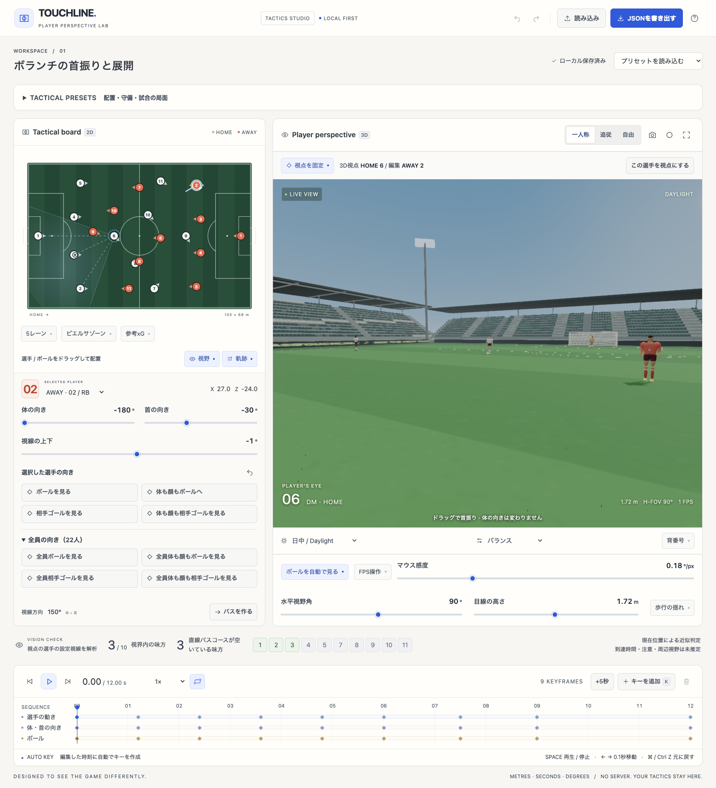
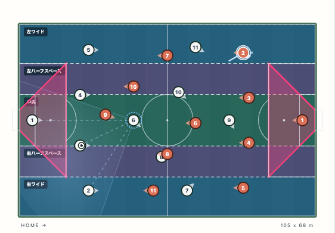
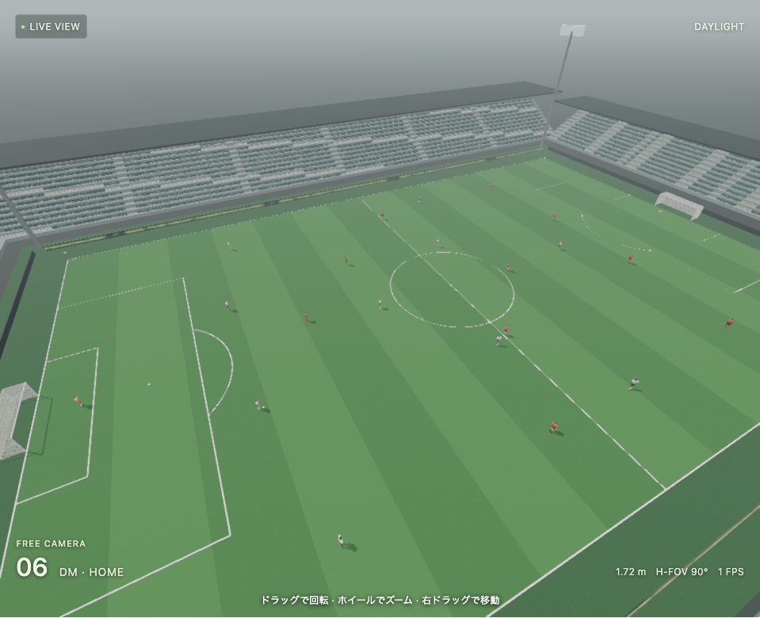

# TOUCHLINE — Player Perspective Lab

サッカーの **2D戦術ボード / 選手の一人称3D / キーフレーム時間軸** を同期する、ブラウザ完結の戦術スタジオ。

**Vite+ · React · TypeScript · Tailwind CSS 4 · Three.js · Node 26 · pnpm 12**

## 画面

実際のブラウザで撮影した画面です。画像はこのリポジトリ内に保存しています。視点をHOME 6に固定し、AWAY 2を編集している例です。







## 起動

Node.js **26.13.0** と **pnpm 12.16.1** を使用します。`.node-version` と `packageManager` で固定しています。グローバルなVite+インストールは不要です。pnpmが未導入の場合は、Node 26環境で `npm install --global pnpm@12.16.1` を実行してください。

```sh
git clone https://github.com/ks250206/football-tactics-board-3d.git
cd football-tactics-board-3d
pnpm install --frozen-lockfile
pnpm run dev
```

表示されたローカルURLを開きます。スマートフォンから同一LANで試す場合は、開発端末のIPアドレスとポート5173を指定してください。開発サーバーは信頼できるネットワークだけで使用してください。

```sh
pnpm run typecheck
pnpm test
pnpm run build
pnpm run preview
```

ビルド後の `dist/` は静的Webサーバーで配信できます。`file://` からHTMLを直接開く形式ではありません。`base: './'` のためサブディレクトリへの配置にも対応します。

## できること

- 22選手とボールの2D配置編集。ドラッグした位置を即座に3Dへ反映。
- 一人称・後方追従・自由カメラ。どの選手の視点にも切り替え可能。視点を固定すると、別の選手を選択・移動してもカメラの対象を維持。
- **体の向き / 首の相対角 / 上下視線を独立して編集**。一人称画面のドラッグでも首振りを作成。
- キーフレームの追加・削除、自動キー、スクラブ、0.25–2倍再生、ループ、時間の延長、Undo / Redo。
- 選択選手から受け手をクリックして1.2秒のパスを作成。保持者、自由なボール位置、高さ、浮き高さの調整。
- 水平視野角55–120°、目線1.40–2.05 m、歩行時の微小な揺れのON / OFF。
- 現在の視野に入る味方、他の選手による遮蔽、直線パスコース上の相手を**別々に判定**。
- ビルドアップ / スルーパス / オーバーラップの編集可能なデモ。
- ブラウザへの自動保存、JSON入出力、3DのPNG保存、対応ブラウザでのWebM / MP4録画。
- デスクトップとモバイルのレスポンシブレイアウト。モバイルは軽量モードで開始。

## 最初の操作

1. 左のボードで6番を選ぶ。右の一人称映像が6番の目線になる。
2. 時間軸の2秒付近をクリックする。
3. 6番をドラッグする。必要なら体の向きと首の向きを調整する。この時刻に自動でキーが作られる。
4. 「パスを作る」を押し、受け手の選手をクリックする。
5. 再生して、受け手がどの角度・距離に見えるかを確認する。

ボール自体をクリックすると、保持者・高さ・次区間の浮き高さを編集できます。自由カメラは左ドラッグで回転、右ドラッグで平行移動、ホイールでズームします。

### ショートカット

| 操作 | キー |
| --- | --- |
| 再生 / 一時停止 | Space |
| 現在時刻にキーを追加 | K |
| 0.1秒前後に移動 | ← / → |
| 1秒前後に移動 | Shift + ← / → |
| 元に戻す | Ctrl / Cmd + Z |
| やり直す | Ctrl / Cmd + Shift + Z |
| パス選択 / ヘルプを閉じる | Esc |

入力欄の編集中は、その入力操作を優先します。

## レンダリング

- AgXトーンマッピング、PBRマテリアル、屋外の空グラデーション、環境反射、霧。
- 夕方・日中・ナイトゲームで光源、色温度、空、照明器具の発光を切り替え。
- 選手周辺に追従するシャドウマップ。通常2048px、シネマティック4096px。
- 模様・白線・微細凹凸を持つ芝。バランス24,000本 / シネマティック65,000本のインスタンス芝と風。
- 個別座席のインスタンシング、段床、屋根鉄骨、広告灯、照明塔、ゴールポスト・ネット。
- オリジナルの関節付き人体。ユニフォーム生地、番号、顔・髪、腕・脚の走行ポーズ。
- 12個の五角形と20個の六角形を球面に投影したサッカーボール。
- ピッチと下地の地面を0.5 m離し、芝・白線・ゾーンの深度オフセットを分けて重なりのちらつきを抑制。カメラのnear面は一人称0.06 m、追従0.2 m、自由0.5 m。芝の細い葉はカメラから12〜32 mで縮小し、遠景のサブピクセルのちらつきを抑える表示上の近似です。
- 全モードFXAA。シネマティックではSSAOと控えめなブルームを追加。

高品質モードはGPU負荷が増えます。フレームレートが低い場合は「バランス」または「軽量」へ変更してください。WebGL 2が必要です。WebGPUは必須ではありません。

## データとプライバシー

サーバー、アカウント、APIキー、CDN素材、解析用トラッカーはありません。モデルとテクスチャは実行時にローカル生成されます。編集内容は現在のブラウザの `localStorage` に保存され、外部には送信されません。JSONに書き出して別の端末へ移してください。ブラウザの保存容量不足などでは警告を表示します。

読み込みはversion 1のスキーマを検証します。22選手、有限の数値、範囲、所有者、キーの時間順序と境界を確認し、2 MB超のファイルは拒否します。

録画は**3Dキャンバスのみ / 音声なし / 実時間**です。録画中にタブを隠すと録画を停止します。描画性能が低い場合、実際の出力フレーム数も低下します。形式はブラウザのMediaRecorder対応によります。オフラインの高品質フレーム書き出しではありません。

このリポジトリの公開設定は変更しません。CIは検証とビルド成果物の作成のみを行い、外部サイトへは自動公開しません。

## 近似と未実装事項

これは**ユーザーが指定した配置と視線からの幾何学的なプレビュー**であり、実際の選手の視覚や試合結果を推定するものではありません。

- 位置は区間ごとの直線補間。衝突回避、加速度制限、戦術AI、接触、足とボールの厳密な同期はありません。
- ボールの飛行はキー間の放物線形状です。重力、回転、バウンド、摩擦を解く物理シミュレーションではありません。
- 視野の判定は水平 / 垂直角と選手の単純な遮蔽体で近似。実際の注意、周辺視の認識性能、眼球運動、実映像からの追跡は扱いません。
- パスコース判定は現在の相手位置から直線区間までの距離のみ。相手の速度、将来位置、ボールの到達時間は考慮しません。
- 自由カメラ表示中もVISION CHECKは3D視点の選手の設定視線を解析します。視点を固定している場合、編集対象とは別の選手です。
- 人物は滑らかなオリジナルのプロシージャルモデルです。フォトスキャンやモーションキャプチャ、実在選手の顔ではありません。
- VR / WebXR、共同編集、実試合動画の取り込み、音声、選手の追加削除は未実装です。

## テスト

```sh
pnpm test
pnpm exec playwright install chromium
pnpm run test:e2e
```

ブラウザテストはNode 26でのブラウザ展開処理に対応したPlaywright 1.64.1を使用します。CIは同じNode・pnpmの固定版と `pnpm install --frozen-lockfile` を使用します。依存のビルドスクリプトは `pnpm-workspace.yaml` で明示したものだけを許可します。

単体テストは補間、角度ラップ、保持、パス、視界、入力検証、配置、守備、向き操作を対象とします。PlaywrightではWebGL起動、編集、自動キー、再生、JSON、モバイル表示を確認し、`artifacts/` にスクリーンショットを作成します。CI成果物には配信用ビルド、テスト画像、ソースアーカイブを含めます。

READMEの画像は、ビルド後に別ターミナルで `pnpm run preview -- --host 127.0.0.1` を起動し、`pnpm run docs:screenshots` で `docs/images/` に再生成できます。

## 構成

```text
src/core.ts       純粋なシーンモデル、補間、視野、入出力検証
src/world.ts      芝・スタジアム・空・ライティング
src/athlete.ts    人体リグとサッカーボール
src/engine.ts     Three.js描画・カメラ・後処理・リソース破棄
src/Stage.tsx     Reactと描画エンジンの境界
src/Board.tsx     SVG戦術ボードとドラッグ操作
src/Timeline.tsx  時間軸・キーフレームUI
src/tactics.ts    配置・守備・向き・FPS入力の純粋関数
src/TacticsPanel.tsx 配置と局面プリセットUI
src/OrientationControls.tsx 個別・全員の向き操作UI
src/App.tsx       編集状態・履歴・永続化・入出力
```

Three.jsとTailwindは通常のパッケージ依存です。Vite+は`vite-plus`と対応するcore aliasを固定し、`vp`経由でdev / build / testを実行します。

## 配置・守備・局面プリセット

「TACTICAL PRESETS」で対象チームを選び、フォーメーションと配置するサードを指定します。HOMEは+x、AWAYは−x方向へ攻撃します。配置・サード・各バー・カスタム入力はチームごとに保持し、対象チームを切り替えるとその設定へ戻ります。切り替えだけでは選手の配置を変更しません。AWAYではサードボタンを左からアタッキング→ミドル→ディフェンシブの順に並べ、高さバーも反転して、前進（正値）が画面左・後退（負値）が画面右に対応するようにしています。36種類（4-4-2、4-3-3、4-2-3-1、3-5-2、3-2-5、2-3-5など）に加え、各列1〜9人・2〜10列・合計10人のカスタム配置を入力できます。GKを含め常に11人です。

- コンパクトさ：0〜50%でフィールド選手の前後長を52〜37 m、50〜100%で37〜6 mに変更します。横幅は別のバーで調整します。
- 横の広さ：20〜62 m。2人の列は指定幅の半分に配置します。
- 左右の偏り：−100〜100%。攻撃方向基準で負が左、正が右。各列の横幅と間隔を保ち、タッチラインから2 mの範囲内でブロック全体を寄せます。横幅を狭めると寄せられる距離が増えます。GKはフィールド選手の移動量の1/4だけ寄せます。
- フィールドチルト（陣地の高さ）：選んだサードの中心から±20 mの前後調整。端ではブロック全体をフィールド内に収めます。このバーではフィールド選手のみを移動し、GKの現在の位置・向き（手動編集を含む）は維持します。一般の分析指標である敵陣タッチ数・保持率のfield tiltを算出する機能ではありません。

配置・バーは現在時刻のキーを変更します。途中への挿入では前後の既存キーを維持します。ボール保持者を移動すれば球も足元へ追従します。フォーム上の配置設定は適用用の値で、手動編集後の実際の形を自動認識するものではありません。

守備プリセットは対象チームの全時間に適用します。同時に有効な自動守備チームは1つです。ゾーンは適用時の位置を基準にボール位置の変化の40%を前後、65%を左右に反映し、GK以外を同じ量だけスライドさせます。保持者がいる場合は足元の球位置が基準です。マンマークは適用時の近い相手から重複なく割り当て、担当相手から自陣ゴール方向へ1.6 mの位置に追従します。プレッシング判断、受け渡し、マークの優劣、衝突回避は推定しません。

守備プランはJSONと自動保存に含まれ、読み込み時に座標・チーム・相手・割り当ての重複を検証します。手動配置に戻すと、各既存キーで評価した守備位置を焼き込みます。自動守備側の選手を手動操作・再配置したときも焼き込んで解除します。キー間は直線補間になるので、焼き込み前の全中間時刻と厳密に同一とは限りません。

局面シーケンスは対象チームの立場で、相手も含めた12秒の教材用の動きを生成します。自陣ビルドアップ、中盤前進、敵陣での崩し、サイドチェンジ、サイドの数的優位、カウンター、レストディフェンス、ハイプレス、ミドルブロック、ローブロック、即時奪回、リトリートの12種類です。動きはあらかじめ定めた例で、試合データの再現や自律的な戦術AIではありません。読み込みは全シーケンスを置き換え、Undoで復元できます。

## カメラの固定・選手の向き・FPS操作

3D画面上の「視点を固定」で、現在の視点の選手を固定します。2Dボードや「編集する選手」で別の選手を選んでドラッグ・向き編集しても、3D視点は固定した選手のままです。ボードの破線リングが視点の選手、白いリングが編集対象を表します。「この選手を視点にする」で編集対象へ視点を切り替え、「視点を固定」を解除すると通常の選択追従に戻ります。3D画面内の首振り・FPS操作・VISION CHECKは視点の選手を対象にします。

選手の向きパネルから、選択選手の「ボールを見る」「体も顔もボールへ」「相手ゴールを見る」「体も顔も相手ゴールを見る」を実行できます。「全員の向き（22人）」を開くと、同じ4操作を両チーム全員へ適用できます。相手ゴールは各チームの攻撃先のゴール中央（高さ1.22 m）です。視線だけの操作でも首の可動域±110°を超える分は体が回ります。体も顔も向ける操作では首の相対角を0°にします。現在時刻のキーに向きを記録し、Undoで戻せます。自動視線を解除し、自動守備側の選手を含む操作では守備位置を焼き込んで手動編集に切り替えます。


初期状態では全選手の視線がボールへ向きます。首の相対角±110°を超える場合は体も回します。保持者は自分の足元を見下ろさず、体の前を見ます。これは表示上の自動視線で、元のキーの体・首・上下視線は変更しません。「ボールを見る」は選択選手の現在キーへ向きを記録します。「体も顔もボールへ」は体をボールの方角へそろえ、首の相対角を0°にして、体と顔を同じ方角へ向けます。上下視線も球へ合わせます（±45°まで）。手動の体・首・視線編集は自動視線を解除します。JSON保存対象はキーに記録した視線であり、表示用トグルは含みません。

一人称で「FPS操作」を有効にし、3D画面をクリックするとマウスポインタを固定します。WASDで視線基準の前後左右へ移動し、マウスで体を旋回・上下に視線を移動します。速度設定は5 m/s（停止・大きな飛躍防止のため1フレームの経過を0.05秒に制限し、低FPSでは実効速度が低下）、斜めの移動速度は正規化、フィールド境界で停止、上下は±45°です。マウス感度は0.04〜0.60°/pxで、通常の首振りドラッグにも適用します。Esc・別カメラ・FPS解除・タブ非表示で固定を解除します。ウィンドウがフォーカスを失うと押下状態を破棄します。操作は再生を停止して現在時刻のキーを編集します。時間経過を伴う走行録画や身体運動モデルではありません。録画開始時にはFPS操作を解除します。

## フィールド着色と参考xG

5レーンとビエルサゾーンは独立したトグルで、2Dと3Dの両方に表示します。5レーンは幅方向の境界をz=−34、−20.16、−9.16、9.16、20.16、34 mとし、ペナルティーエリア・ゴールエリア幅に沿わせています。左/右ラベルはHOMEの攻撃方向基準です。

ビエルサゾーンは**左右のゴールポストからペナルティーエリア前方の角へ伸ばした線で囲まれる台形**です。+x側の頂点は(36,−20.16)、(52.5,−3.66)、(52.5,3.66)、(36,20.16) mで、ゴールポストからゴールエリア前角を通る斜線をペナルティーエリア前辺まで延長しています。反対ゴール前も鏡映して表示します。参考図のパーセンテージは転用していません。

参考xGは初期OFF。保持者のチーム（自由球では選択選手のチーム）が、現在のボール地点から相手ゴールへ地上シュートすると仮定した**未学習・未校正の説明用スコア**です。

```
d = ゴール中心までの平面距離 (m)
a = 両ゴールポストのなす開口角 (rad)
score = sigmoid(-1.50 - 0.08 * d + 0.90 * a)
```

係数は説明用に置いた値で、実測データの回帰係数ではありません。GK、ブロッカー、守備圧、利き足、シュート種別、球速・弾道を考慮せず、校正された得点確率として比較・評価に使用できません。保持局面の得点確率や将来のチャンス価値でもありません。ゴールライン以遠、タッチライン外、高さ0.5 m超では対象外にします。距離と角度を用いたモデルと選手要因の違いについては[Bayes-xG原論文](https://arxiv.org/abs/2311.13707)を参照してください。本実装は同論文の学習済みモデルを使っていません。

保存データが不正な場合は自動保存を止め、元データを上書きせずデモを表示します。警告から元データをダウンロードするか、「元データを退避して保存を再開」でブラウザ内の別キーにバックアップを作ってから保存を再開できます。

マウス固定が非対応・拒否された場合は、3D画面にフォーカスがある間のWASD移動と画面内のマウス移動による旋回へ切り替えます。マウスボタンを押し続ける必要はありません。Escまたは画面外へのフォーカス移動で停止します。自動テストのFPSシナリオも実際の固定取得か、この拒否時の代替操作を検証します（固定APIのモックは使用しません）。ネイティブ固定中の相対入力は、自動操作の絶対座標移動では再現できないため、DOMの相対MouseEventを入力境界へ送ってWASDとの同時処理を検証し、テスト注記へ記録します。固定APIの取得は実際に行いますが、この分岐で実マウス機器の入力までは検証しません。

FPS入力はマウスの差分と押下中のWASDを同一フレームでまとめ、最新の編集済み姿勢へ一度に適用します。移動と視点変更を同時に続けても、互いの姿勢変更を古い表示フレームで上書きしません。

UIはオフホワイトの背景・ニュートラルなグレーの文字・青いアクセントを使用します。3Dの初期ライティングは日中で、白色の直射光とニュートラルな地面側環境光を使用します。夕方・夜間への切り替えも引き続き利用できます。

補足文・ラベルは濃いスレート色で表示し、小さい文字のコントラストを確保します。ボードの5レーンは暗い青・紫・青緑を2Dで62%、3Dで55%の不透明度で塗り分け、明るい破線と、濃い背景に白文字のラベルで区切ります。視野・軌跡も青系、ビエルサゾーンは鮮明なピンク色（2Dで38%、3Dで50%の塗りと輪郭）を使い、重なっても黄色がかぶらない配色にしています。

3Dの露出は0.90に抑え、中央レーンも明るいパステル色を避けています。レーン→ビエルサ塗り→輪郭の順序を固定し、重ねた際にもゾーンを見分けられるようにしています。

可読性のため、操作ラベル・入力欄は基本14px、説明文は13px以上とし、見出し・数値は太く表示します。モバイルではカメラ操作やフォームを折り返し、文字を縮めて収めるレイアウトを避けています。
